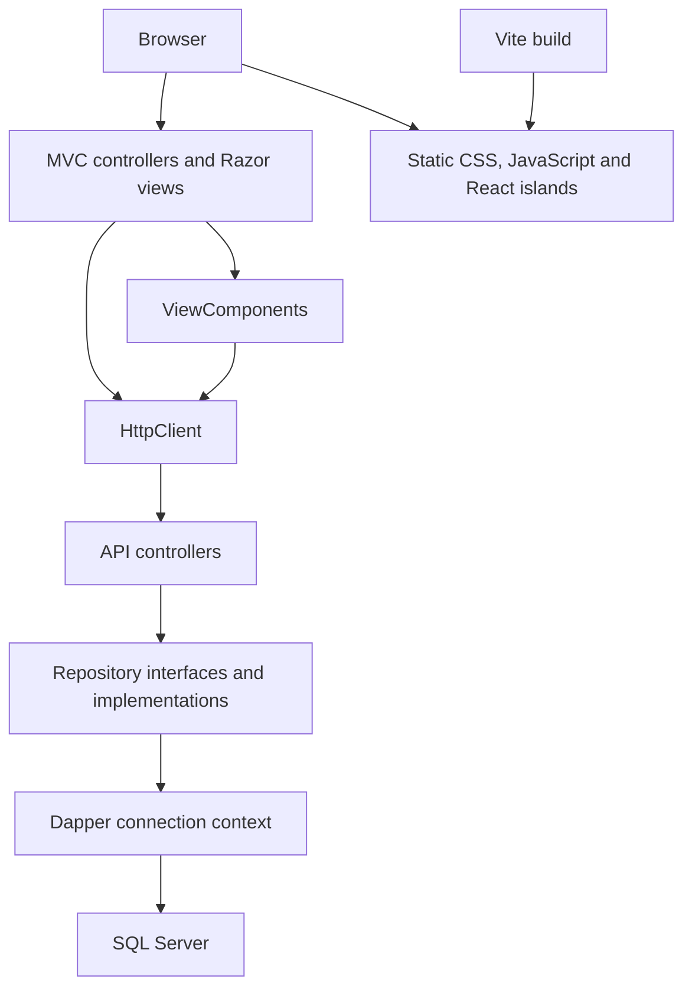
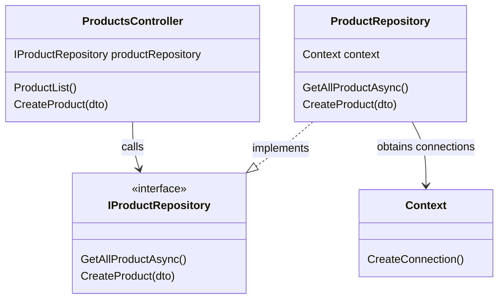
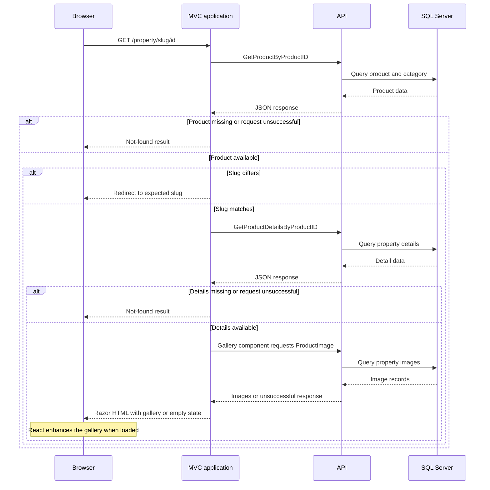
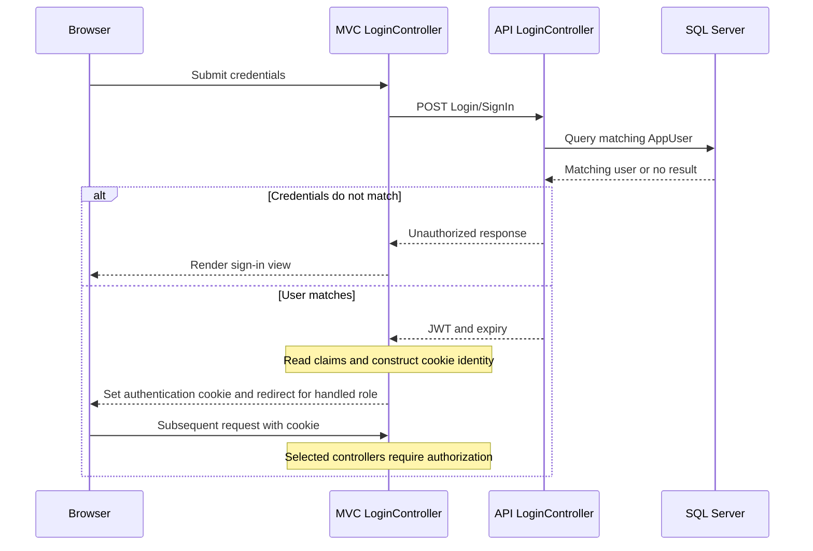
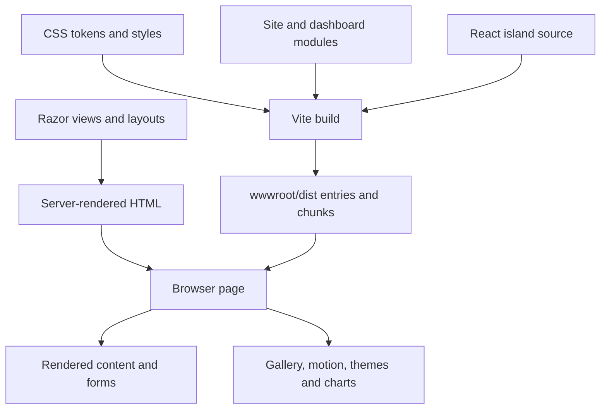

# RealEstate Dapper

### Property discovery and management with ASP.NET Core, SQL Server, and a modern Razor interface

RealEstate Dapper combines a public property website, an administrative dashboard, and an estate-agent workspace. The application uses a separate ASP.NET Core Web API for data access and an ASP.NET Core MVC application for server-rendered pages. Its redesigned interface adds responsive layouts, light and dark themes, animation, and focused React components while retaining the existing C# application structure.

**Project status:** Educational and portfolio application. The interface redesign is included; several backend workflows and production-security requirements remain incomplete. See [Current limitations](#current-limitations) before running a public demo.


## Contents

- [Overview](#overview)
- [Features](#features)
- [Interface preview](#interface-preview)
- [Screenshot showcase](#screenshot-showcase)
- [Technology stack](#technology-stack)
- [Architecture](#architecture)
- [Repository structure](#repository-structure)
- [Getting started](#getting-started)
- [Frontend development](#frontend-development)
- [Application routes and API](#application-routes-and-api)
- [Current limitations](#current-limitations)
- [Security and deployment readiness](#security-and-deployment-readiness)
- [Troubleshooting](#troubleshooting)
- [Verification checklist](#verification-checklist)
- [Roadmap](#roadmap)
- [Author](#author)

## Overview

The project explores property discovery, listing administration, and agent workflows through a database-backed web application. Visitors can browse advertisements and inspect property details. Management screens organize listings, categories, employees, amenities, services, and website content. A dedicated MVC Area contains the estate-agent dashboard and advert-management screens.

The redesign builds on the original educational implementation. It improves presentation, navigation, empty states, and selected error paths without replacing Razor MVC with a single-page application.

## Features

| Area | Included functionality |
| --- | --- |
| Public website | Homepage, property advertisements, search by keyword/category/city, and property detail pages with readable slug URLs |
| Property presentation | Photo gallery, price and location information, descriptive details, amenities, and agent/contact presentation |
| Administration | Dashboard and management screens for properties, categories, amenities, employees, services, popular locations, homepage content, and featured advertisements |
| Estate-agent workspace | Dedicated dashboard, active/passive adverts, and advert-creation workflow |
| Authentication foundation | API sign-in issuing JWTs, MVC cookie sign-in, and role-dependent navigation; authorization coverage is incomplete |
| Visual design | Shared design tokens, light/dark themes, responsive navigation, dashboard tables, and consistent forms |
| Interaction | GSAP animation, Lenis scrolling on supported public-page contexts, and React islands for the property gallery and title |
| Charts and statistics | Chart.js integration, statistics endpoints, and a SignalR category-count hub; some chart content remains sample data |
| Resilience | Explicit empty models for typed components, API transport-error handling, and styled status pages |

The presence of a screen does not imply that every operation is complete. Known nonfunctional actions and placeholders are listed below.

## Interface preview

The following screenshots are included in the project package. They illustrate the supplied interface and are not a guarantee that every pictured workflow is complete.

| Property details | Administration |
| --- | --- |
|  |  |

<details>
<summary>More screenshots</summary>


| Mobile homepage | Mobile property details |
| --- | --- |
|  |  |

</details>

## Screenshot showcase

The sections below reserve space for additional screenshots. Replace each italic placeholder with an image when ready. Suggested filenames are given in Markdown comments, so the README remains clean and does not show broken image links before those files exist.

### Property search and filtering

*Screenshot to add: search controls and matching property cards on a desktop screen.*

<!-- Replace the placeholder above with:  -->

### Property gallery and details

*Screenshot to add: the gallery, pricing, property information, and amenities in one representative view.*

<!-- Replace the placeholder above with:  -->

### Management workspace

*Screenshot to add: the property management table and its available controls. Use demonstration data.*

<!-- Replace the placeholder above with:  -->

### Estate-agent advert form

*Screenshot to add: the estate-agent creation form, showing its fields and layout.*

<!-- Replace the placeholder above with:  -->

### Responsive layouts

*Screenshots to add: the same page at phone and tablet widths.*

<!-- Replace the placeholder above with:
| Phone | Tablet |
| --- | --- |
|  |  |
-->

### Light and dark themes

*Screenshots to add: the same page in both themes for a direct visual comparison.*

<!-- Replace the placeholder above with:
| Light | Dark |
| --- | --- |
|  |  |
-->

### API documentation

*Screenshot to add: the Swagger endpoint overview from the running local API.*

<!-- Replace the placeholder above with:  -->

## Technology stack

Versions below describe the supplied project manifests; the lockfile records resolved frontend dependencies.

| Layer | Technologies |
| --- | --- |
| Runtime | C#, .NET 8, ASP.NET Core |
| Web application | MVC controllers, Razor views, ViewComponents, MVC Areas |
| API and persistence | ASP.NET Core Web API, Dapper 2.1.66, Microsoft.Data.SqlClient 6.1.4, SQL Server |
| API documentation | Swashbuckle.AspNetCore 10.1.1 / Swagger |
| Authentication | JWT generation and MVC cookie authentication |
| Realtime foundation | ASP.NET Core SignalR |
| Frontend tooling | Vite 8, npm, ES modules |
| Interactive components | React 19, React DOM, React Bits SplitText |
| Motion | GSAP 3.15, ScrollTrigger, SplitText, Lenis 1.3 |
| Charts | Chart.js 4 |
| Styling | Custom CSS, shared design tokens, locally hosted fonts and Font Awesome icons |

Existing template assets remain in the repository. The redesigned pages use the new frontend bundles rather than the original template stylesheets.

## Architecture

### Architectural approach

RealEstate Dapper is a **two-project, server-rendered web application with a separate HTTP API**. Its main boundaries are presentation, API request handling, repository-based persistence, and a shared SQL Server database.

The UI follows ASP.NET Core MVC and composes reusable page sections with ViewComponents. The API uses controllers, DTOs, repository interfaces, and Dapper implementations. These responsibilities live inside the two application projects; there are no separate BusinessLayer, EntityLayer, or DataAccessLayer projects.

The implementation is not a microservices system or a full React single-page application. Business behavior is distributed across controllers and repositories rather than isolated in a dedicated domain/application-service layer.

### System boundaries



The UI and API run as separate ASP.NET Core processes. The UI normally calls the API from the server, and the browser receives rendered HTML. SQL Server connections are created inside the API project; the UI does not query the database directly.

### Presentation layer: MVC and Razor

`RealEstate_Dapper_UI` owns page routing, rendering, layouts, browser authentication cookies, and presentation-level coordination.

| Component | Responsibility | Example |
| --- | --- | --- |
| MVC controllers | Accept route/form parameters, request API data, select views, and redirect after operations | `PropertyController` |
| Razor views | Render typed models, form fields, and page content | `Views/Property/PropertySingle.cshtml` |
| ViewComponents | Load and render reusable sections with their own data requirements | `_PropertySliderComponentPartial` |
| Shared layouts | Compose navigation, common assets, and page shells | Public and dashboard layouts |
| MVC Areas | Group estate-agent controllers and views under a separate route scope | `Areas/EstateAgent/` |
| UI DTOs and helpers | Represent API responses and prepare display values | Product and property-image DTOs |
| UI services | Access the current identity and handle API transport failures | `LoginServices`, `ApiUnavailableHandler` |

A ViewComponent is a server-side rendering component, not a React component or an independent service. Its Razor view receives the model supplied by the component. Typed component fallbacks must provide the correct model type even when API data is unavailable.

The detail page combines a typed product model with supplementary values in `ViewBag`. This describes the current implementation; the page does not use one unified, strongly typed aggregate view model.

### API layer and dependency injection



The diagram shows selected members of the existing product implementation. It is not a complete class listing.


`RealEstate_Dapper_Api` exposes JSON endpoints using ASP.NET Core controllers. Controllers accept request parameters or DTOs, call repository interfaces, and return HTTP results.

For example, `ProductsController` receives `IProductRepository` through constructor injection. Its product-list action calls `GetAllProductAsync()` and returns the resulting records with `Ok(...)`. Dependency registration is invoked through `ContainerDependencies()` in API startup.

This interface boundary separates endpoint handling from SQL implementation. It also provides a place to substitute repository implementations for testing, although the package does not include a dedicated automated test project.

Routes combine controller-level prefixes such as `api/[controller]` with action-specific paths. Several endpoints use action-oriented names, and some existing status changes use GET requests. The API should therefore be understood from its actual routes rather than assumed to follow uniform REST conventions.

### Repository and persistence layer

Repositories contain SQL statements and database operations. The Dapper context reads `ConnectionStrings:connection` and returns an `IDbConnection` backed by `Microsoft.Data.SqlClient.SqlConnection`.

A typical repository operation:

1. Defines the SQL query or mutation.
2. Prepares parameters for incoming values.
3. Creates a connection through the context.
4. Calls a Dapper operation such as `QueryAsync<T>()` or `ExecuteAsync()`.
5. Returns DTO results or completes the mutation, then disposes the connection.

For example, property search filters active products by title, category, and city using Dapper parameters. Listing queries join `Product` and `Category` to return category labels with property information.

Dapper maps query results to C# objects; it does not provide Entity Framework-style change tracking or automatically create this application's schema. The included context is a connection factory, not an EF `DbContext`. Schema creation and seed data remain external setup requirements.

### DTO boundaries and data flow

Both projects contain DTO definitions for their respective responsibilities. API DTOs describe incoming payloads and query results; UI DTOs deserialize responses and supply presentation data. They are not maintained in a separate shared-contract project.

This makes JSON shape compatibility important: property names, types, null handling, and list-versus-object responses must match across the HTTP boundary. A successful HTTP response alone does not guarantee that the consuming view receives the correct model.

The UI uses both Newtonsoft.Json and System.Text.Json in different code paths. Changes to serialization behavior should account for the specific caller rather than assuming one global serializer configuration.

### Example: loading a property detail page

For `/property/{slug}/{id}`, the current flow is:

1. `PropertyController.PropertySingle` requests `Products/GetProductByProductID?id=...`.
2. It deserializes the property and returns a not-found result when the request fails or the product is absent.
3. It derives the expected slug and redirects if the incoming slug differs.
4. It requests `ProductDetails/GetProductDetailsByProductID?id=...` for supplementary details.
5. It prepares the product model and `ViewBag` values, then renders the Razor view.
6. The page invokes components, including the image slider, which requests `ProductImage?id=...` separately.
7. Razor renders the gallery fallback and serializes data for the optional React gallery enhancement.

A detail page therefore performs multiple API requests. The main product/details calls are sequential in the controller, and component requests add further work. The implementation does not expose a single aggregate endpoint returning every section of the page.

### Property detail request sequence



The sequence highlights the main product, details, and gallery requests. Other ViewComponents may make additional calls.

### Authentication and identity flow

The implemented sign-in path crosses both projects:

1. The browser submits credentials to the UI's `LoginController`.
2. The UI posts the credentials to `Login/SignIn` on the API.
3. The API queries `AppUser` and generates a JWT containing user and role information.
4. The UI reads the token claims, normalizes selected identity/role claims, and stores the token as a claim.
5. ASP.NET Core issues the UI authentication cookie.
6. Subsequent browser requests use the cookie identity; selected controllers enforce `[Authorize]`.

`LoginServices` obtains the user identifier from the current HTTP context. Role claims influence redirects and menu visibility.

This is the current authentication flow, not a complete security boundary. The UI reads JWT contents without establishing signature validation in that path, API JWT validation is not configured in the supplied startup, and authorization coverage is incomplete. Menu visibility must not be treated as enforcement of permissions. Specific remediation is listed under security and deployment readiness.

### Authentication sequence



This describes existing behavior. Token validation, password handling, and complete authorization remain remediation items; the diagram does not imply they are already implemented.

### Frontend composition and build pipeline

The browser interface combines server-rendered HTML with progressive JavaScript enhancements.

| Technology | Architectural role |
| --- | --- |
| Razor | Produces the initial page and form markup on the server |
| Custom CSS | Provides shared tokens, themes, layouts, and component styling |
| JavaScript modules | Handle navigation, theme switching, and dashboard behavior |
| React islands | Enhance selected property-page regions without owning application routing |
| GSAP | Animates titles and selected page elements |
| Lenis | Adds smooth scrolling in supported public-page contexts |
| Chart.js | Renders dashboard charts |
| Vite | Bundles frontend source into static files served by ASP.NET Core |

`ClientApp` is a build workspace inside the UI project. Vite outputs to `wwwroot/dist`, with separate public-site and dashboard entries and split chunks for selected dependencies. Razor references stable entry filenames with versioned URLs.

The browser does not need a separate React application server. Vite's watch script rebuilds assets, while ASP.NET Core continues to host pages and process form submissions. Frontend changes can preserve existing controller routes and form contracts when the markup and submitted field names remain compatible.

### Frontend build and rendering diagram



Source files are compiled during frontend development or release preparation. Razor rendering happens when the running application serves a page. These are separate stages.

### Errors and unavailable dependencies

The UI registers `ApiUnavailableHandler` for its HTTP clients. It catches transport exceptions and qualifying timeouts, logs the failure, and returns a synthetic HTTP 503 response to the caller. Existing controller/component branches then choose their fallback behavior.

This handler does not retry requests, cache responses, repair API errors, or validate JSON. It also does not guarantee that the browser receives HTTP 503: a caller may render an empty page section or return a different status, such as the property controller's not-found result.

Typed component fallback models prevent Razor model mismatches. Status-code re-execution provides a styled page for applicable empty error responses, while production exception handling is configured separately in UI startup.

### SignalR boundary

The API maps `SignalRHub` at `/SignalRHub`. Its `SendCategoryCount` method calls the category-count statistics endpoint and broadcasts `ReceiveCategoryCount` to connected clients.

This is a specific realtime integration. It does not establish automatic change tracking for the database or realtime synchronization for every dashboard metric. The hub currently uses a hardcoded localhost API address.

### Runtime configuration and deployment boundaries

| Concern | Current owner |
| --- | --- |
| Database connection | API configuration and Dapper context |
| UI API base address | UI `ApiSettingsKey:BaseUrl`, alongside remaining hardcoded URLs |
| Browser cookie sign-in | UI authentication middleware |
| Token generation | API token helpers |
| CORS and SignalR | API startup |
| Static files and page routes | UI startup |
| CSS/JavaScript compilation | `ClientApp` / Vite |

The two applications can run on the same development machine or be deployed as separate processes with appropriate network connectivity. The UI must reach the API, and the API must reach SQL Server. Any browser-to-API integration also needs a browser-reachable API URL and suitable origin configuration.

The package does not define an orchestration platform, deployment automation, distributed cache, background job queue, or dedicated domain-service layer. Adding any of these would be a future architectural decision rather than a description of the current system.


## Repository structure

Paths below are relative to the folder containing `RealEstate_Dapper_Api.sln`.

| Path | Purpose |
| --- | --- |
| `RealEstate_Dapper_Api.sln` | Visual Studio solution |
| `RealEstate_Dapper_Api/Controllers/` | HTTP API endpoints |
| `RealEstate_Dapper_Api/Repositories/` | Dapper database access |
| `RealEstate_Dapper_Api/Dtos/` | API transfer objects |
| `RealEstate_Dapper_Api/Models/DapperContext/` | SQL connection factory |
| `RealEstate_Dapper_Api/Containers/` | Dependency registration |
| `RealEstate_Dapper_Api/Tools/` | Token-related helpers |
| `RealEstate_Dapper_Api/Hubs/` | SignalR hub |
| `RealEstate_Dapper_UI/Controllers/` | MVC request handling |
| `RealEstate_Dapper_UI/Views/` | Razor views and shared component templates |
| `RealEstate_Dapper_UI/ViewComponents/` | Reusable server-rendered page components |
| `RealEstate_Dapper_UI/Areas/EstateAgent/` | Agent workspace |
| `RealEstate_Dapper_UI/Services/` | Login and API availability helpers |
| `RealEstate_Dapper_UI/ClientApp/` | Frontend source and npm configuration |
| `RealEstate_Dapper_UI/wwwroot/` | Public static assets, including compiled frontend output |
| `screenshots/` | Interface previews |
| `REDESIGN.md` | Frontend build and design notes |
| `CHANGES.md` | Redesign changes and recorded limitations |

## Getting started

### 1. Prerequisites

- .NET 8 SDK.
- SQL Server and the matching application database.
- Git.
- Visual Studio with ASP.NET and web development support, or an editor and terminal.
- SQL Server Management Studio or another SQL Server client for database setup.
- To rebuild frontend assets: a Node.js release satisfying the supplied lockfile requirement, `^20.19.0 || >=22.12.0`, with npm. Node.js is unnecessary when using the included compiled assets without changing frontend source.

### 2. Clone the repository

```bash
git clone https://github.com/karimBoukai/RealEstate_Dapper.git
cd RealEstate_Dapper
```

All following commands assume this directory contains the solution file and both project directories.

### 3. Prepare the database

The application expects an existing SQL Server database named `DbDapperRealEstate` by default.

**The supplied package does not include a SQL schema script, database backup, migration workflow, or seed dataset.** An empty database is insufficient. Obtain the matching schema and suitable development data from the maintainer before expecting database-backed features to work.

For a reproducible setup, a future database package should include tables, keys, relationships, and anonymized seed records. Do not publish real customer data or account credentials.

### 4. Configure the API

The API reads `ConnectionStrings:connection`. The included local Windows-authentication example in `RealEstate_Dapper_Api/appsettings.json` is:

```json
{
  "ConnectionStrings": {
    "connection": "Server=localhost;Database=DbDapperRealEstate;Trusted_Connection=True;TrustServerCertificate=True;"
  }
}
```

Keep the other configuration sections when editing this value. Change the server/instance name to match your SQL Server installation. Windows integrated authentication must be available to the account running the API.

For a private connection string, ASP.NET Core also reads the `ConnectionStrings__connection` environment variable. For example, in the PowerShell terminal that will run the API:

```powershell
$env:ConnectionStrings__connection = "Server=YOUR_SERVER;Database=DbDapperRealEstate;User Id=YOUR_DB_USER;Password=YOUR_LOCAL_PASSWORD;TrustServerCertificate=True;"
```

Use local credentials only in your own environment. `TrustServerCertificate=True` is a development convenience; production requires appropriate certificate validation.

### 5. Configure the UI

`RealEstate_Dapper_UI/appsettings.json` contains:

```json
{
  "ApiSettingsKey": {
    "BaseUrl": "https://localhost:44387/api/"
  }
}
```

Keep the trailing slash. Some components and the SignalR hub still contain hardcoded localhost API addresses. Changing this setting alone does not update every request; retaining the default HTTPS ports is the simplest local setup.

### 6. Restore and build

Run from the solution directory:

```bash
dotnet dev-certs https --trust
dotnet restore RealEstate_Dapper_Api.sln
dotnet build RealEstate_Dapper_Api.sln
```

The certificate-trust command is intended for local development on a supported platform.

### 7. Start both applications

In terminal one, from the solution directory:

```bash
dotnet run --project RealEstate_Dapper_Api/RealEstate_Dapper_Api.csproj --launch-profile https
```

In terminal two, from the same directory:

```bash
dotnet run --project RealEstate_Dapper_UI/RealEstate_Dapper_UI.csproj --launch-profile https
```

| Application | Default address |
| --- | --- |
| Public website | https://localhost:44391/ |
| Sign-in | https://localhost:44391/Login/Index |
| API Swagger UI | https://localhost:44387/swagger |

Alternatively, open the solution in Visual Studio, configure both projects as startup projects, and use matching HTTPS or IIS Express profiles.

### 8. Sign in with development data

Sign-in queries the `AppUser` table. No documented demo credentials or automatic account-seeding process are supplied. Use a suitable local test account from your database. Role values influence redirects and menus, but they do not establish complete authorization enforcement.

## Frontend development

The package includes `wwwroot/dist`, so rebuilding is optional unless frontend source changes.

```bash
cd RealEstate_Dapper_UI/ClientApp
npm ci
npm run build
```

For continuous rebuilds while editing:

```bash
npm run watch
```

Keep the ASP.NET Core applications running separately. The watch command rebuilds files; it does not launch a standalone React website or provide Vite's normal development-server workflow.

| Source | Purpose |
| --- | --- |
| `src/styles/tokens.css` | Theme colors and shared design tokens |
| `src/styles/` | Shared, public-site, authentication, and dashboard styles |
| `src/site/` | Public-page behavior, animation, and smooth scrolling |
| `src/dashboard/` | Dashboard behavior and charts |
| `src/islands/` | React mounting, property gallery, and animated title |
| `src/vendor/react-bits/` | Vendored SplitText component |

Vite writes stable entry names such as `site.js`, `site.css`, `dashboard.js`, and `dashboard.css`, plus chunks and assets. Razor uses versioned asset URLs for cache invalidation. Commit the complete generated output together when distributing prebuilt assets, and keep `package-lock.json` under version control.

The implementation includes reduced-motion handling, native dashboard scrolling, responsive images, and server-rendered gallery fallback markup. These implementation choices do not constitute a formal accessibility or performance certification.

## Application routes and API

| Route | Purpose |
| --- | --- |
| `/` | Public homepage |
| `/Property/Ads` | Advertisements |
| `/property/{slug}/{id}` | Property details |
| `/Login/Index` | Sign-in |
| `/Dashboard` | Management dashboard |
| `/EstateAgent/Dashboard` | Agent dashboard |
| `/EstateAgent/MyAdverts/ActiveAdverts` | Agent's active advertisements |
| `/swagger` on the API | Generated endpoint documentation in Development |
| `/SignalRHub` on the API | SignalR hub endpoint |

API controllers cover products, product details/images, categories, amenities, employees, users, services, content, contacts/messages, and statistics. Use Swagger against the running API for exact HTTP methods, action routes, and payload schemas.

## Current limitations

These limitations are documented in the supplied implementation and redesign notes:

| Area | Current limitation |
| --- | --- |
| Database setup | Matching schema and seed data are not distributed in the package |
| Admin property creation | `Product/CreateProduct` lacks a POST action; the admin form cannot save |
| Admin property update/delete | Referenced `Product/UpdateProduct` and `Product/DeleteProduct` controller actions are missing |
| Profile | UI calls `Employees` routes that do not match the API's `Employee` routes; username claim mapping also needs attention |
| Agent identity | Property agent component requests `AppUser?id=1` rather than resolving the listing owner |
| Cover image upload | Agent form is not multipart; the existing file input does not implement a complete upload flow |
| Role navigation | Role 5 sign-in redirects to the general dashboard |
| Placeholder content | Some charts, notifications, counters, map/video embeds, newsletter controls, and navigation destinations remain demonstrations |
| State changes | Some delete/status actions use GET links and need safer mutation handling |
| Deployment configuration | Hardcoded localhost endpoints remain |
| Automated verification | No dedicated automated test project is included |

`CHANGES.md` records earlier verification performed during the redesign. Treat those notes as historical checks, not a substitute for testing your own database and environment.

## Security and deployment readiness

This is a local development and portfolio codebase, not a production-ready authenticated service. Before exposing a live instance:

- Replace direct password comparisons in `LoginController` with a password-hashing and verification mechanism, including migration of existing accounts.
- Remove or strictly restrict the standalone `TokenCreate` endpoint, which currently issues tokens from caller-provided user information.
- Move the signing key out of `Tools/JWTTokenDefualts.cs` into private configuration and rotate any key previously shared or used outside local development.
- Configure API JWT authentication and validation, enforce authorization policies, and check record ownership. MVC authorization currently covers only selected controllers.
- Validate tokens before establishing an MVC identity; parsing a JWT is not signature validation.
- Use POST/appropriate mutation methods and antiforgery protection for browser-driven state changes.
- Centralize API addresses, restrict CORS to intended origins, and remove certificate-validation bypasses outside explicitly local development.
- Review input validation, upload handling, cookie policy, exception logging, and handling of personal data.

Deployment requires an ASP.NET Core hosting environment for both applications and access to SQL Server. Hosting the compiled frontend assets alone does not run the MVC application, API, or database. Configure HTTPS, private settings, and database connectivity as part of deployment.

## Troubleshooting

| Symptom | What to check |
| --- | --- |
| Empty lists or unavailable notices | Confirm the API is running and inspect API/UI logs; the UI converts some transport failures into empty states |
| SQL connection errors | Verify SQL Server instance, database name, authentication, and matching schema |
| HTTPS connection errors | Trust the development certificate and use the configured HTTPS profiles |
| Property page returns 404 | Verify the product and its associated detail record exist and both API requests succeed |
| Gallery is empty | Test `api/ProductImage?id=YOUR_PROPERTY_ID` on the API and verify image URLs |
| Gallery model-type exception | Ensure the updated slider component always passes `List<PropertyImageDtos>`, including its empty fallback |
| Missing styles or scripts | Check `wwwroot/dist`, rebuild `ClientApp`, and confirm `/dist/` files load successfully |
| npm rejects Node.js | Use a Node version satisfying the lockfile engine requirement |
| Admin save/edit/delete does not work | Check the known incomplete actions above before changing the view |
| Profile cannot load | Correct the API route and username-claim mismatches |

## Verification checklist

After configuring your environment:

1. Restore and build the solution successfully.
2. Confirm Swagger loads and database-backed endpoints return expected records.
3. Open the homepage, advertisements, search results, and a valid property detail page.
4. Verify gallery images, empty galleries, and invalid-property handling.
5. Exercise sign-in, sign-out, and access to management/agent screens.
6. Verify completed CRUD operations against disposable development records.
7. Stop the API temporarily and inspect the UI's error/empty-state behavior.
8. Test mobile, tablet, and desktop layouts, both themes, keyboard navigation, and reduced motion.
9. Rebuild frontend assets if changed and check browser console/network errors.

## Roadmap

- Distribute a reproducible, anonymized SQL schema and seed dataset.
- Complete admin property creation, editing, and deletion.
- Repair profile retrieval and updates.
- Implement listing-owner resolution and complete image upload handling.
- Enforce authentication, authorization, and record ownership consistently.
- Replace demonstration content with working integrations where intended.
- Consolidate endpoint configuration and deployment settings.
- Add meaningful automated API and end-to-end tests, then CI build checks.

These are planned improvements, not completed features.

## Author

**Karim Boukai** — Software Engineering Graduate

[GitHub profile](https://github.com/karimBoukai) · [Project repository](https://github.com/karimBoukai/RealEstate_Dapper)
