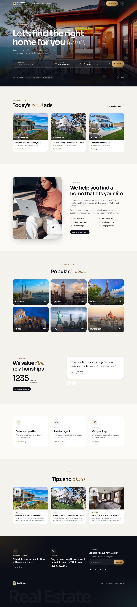
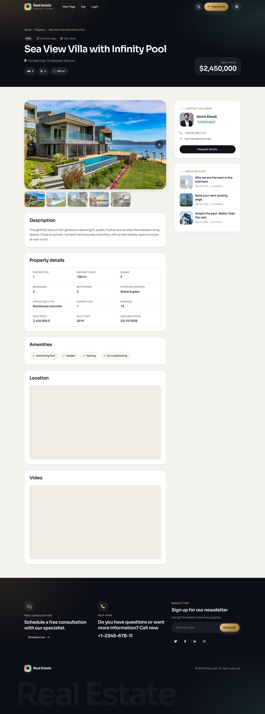
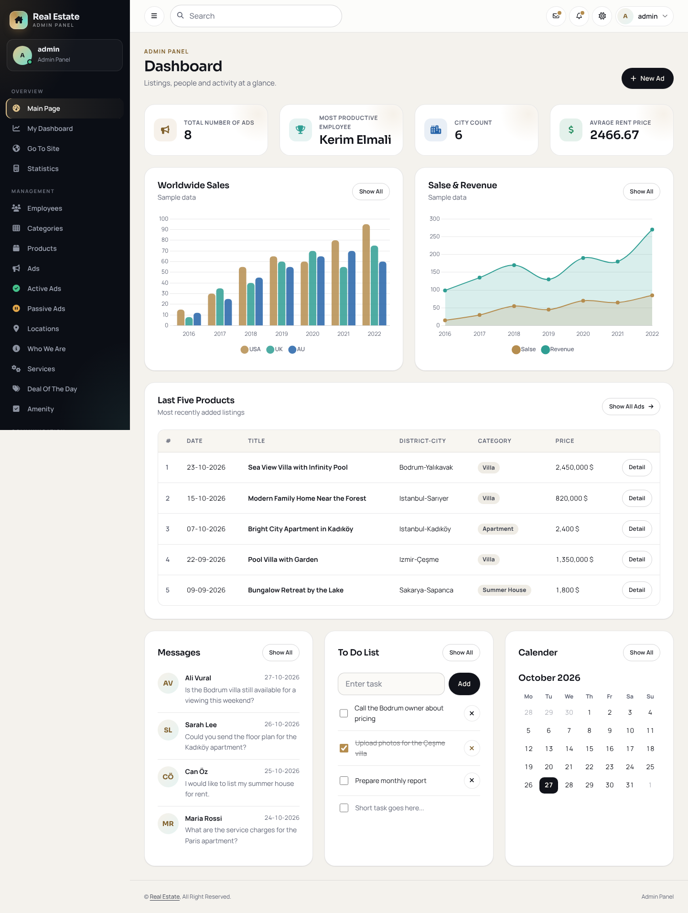
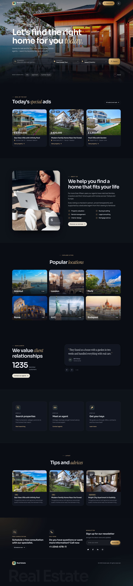
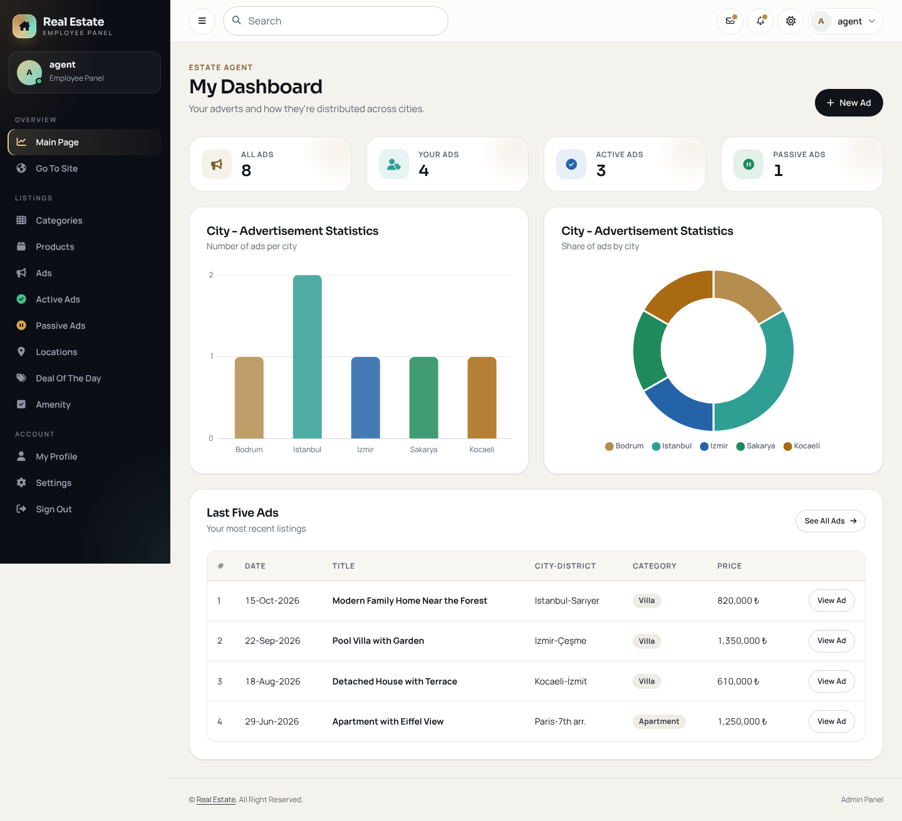
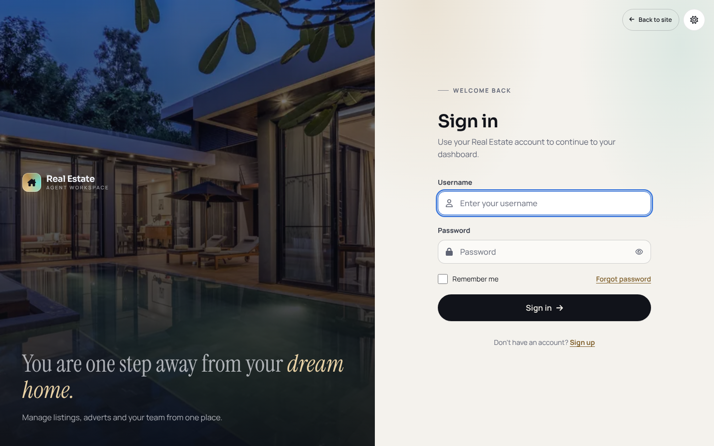
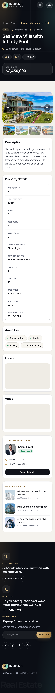

# RealEstate Dapper

### Property discovery and management with ASP.NET Core, SQL Server, and a modern Razor interface

RealEstate Dapper combines a public property website, an administrative dashboard, and an estate-agent workspace. The application uses a separate ASP.NET Core Web API for data access and an ASP.NET Core MVC application for server-rendered pages. Its redesigned interface adds responsive layouts, light and dark themes, animation, and focused React components while retaining the existing C# application structure.

**Project status:** Educational and portfolio application. The interface redesign is included; several backend workflows and production-security requirements remain incomplete. See [Current limitations](#current-limitations) before running a public demo.



## Contents

- [Overview](#overview)
- [Features](#features)
- [Interface preview](#interface-preview)
- [Technology stack](#technology-stack)
- [Architecture](#architecture)
- [Repository structure](#repository-structure)
- [Getting started](#getting-started)
- [Frontend development](#frontend-development)
- [Application routes and API](#application-routes-and-api)
- [Current limitations](#current-limitations)
- [Security and deployment readiness](#security-and-deployment-readiness)
- [Troubleshooting](#troubleshooting)
- [Verification checklist](#verification-checklist)
- [Roadmap](#roadmap)
- [Acknowledgements and licensing](#acknowledgements-and-licensing)
- [Author](#author)

## Overview

The project explores property discovery, listing administration, and agent workflows through a database-backed web application. Visitors can browse advertisements and inspect property details. Management screens organize listings, categories, employees, amenities, services, and website content. A dedicated MVC Area contains the estate-agent dashboard and advert-management screens.

The redesign builds on the original educational implementation. It improves presentation, navigation, empty states, and selected error paths without replacing Razor MVC with a single-page application.

## Features

| Area | Included functionality |
| --- | --- |
| Public website | Homepage, property advertisements, search by keyword/category/city, and property detail pages with readable slug URLs |
| Property presentation | Photo gallery, price and location information, descriptive details, amenities, and agent/contact presentation |
| Administration | Dashboard and management screens for properties, categories, amenities, employees, services, popular locations, homepage content, and featured advertisements |
| Estate-agent workspace | Dedicated dashboard, active/passive adverts, and advert-creation workflow |
| Authentication foundation | API sign-in issuing JWTs, MVC cookie sign-in, and role-dependent navigation; authorization coverage is incomplete |
| Visual design | Shared design tokens, light/dark themes, responsive navigation, dashboard tables, and consistent forms |
| Interaction | GSAP animation, Lenis scrolling on supported public-page contexts, and React islands for the property gallery and title |
| Charts and statistics | Chart.js integration, statistics endpoints, and a SignalR category-count hub; some chart content remains sample data |
| Resilience | Explicit empty models for typed components, API transport-error handling, and styled status pages |

The presence of a screen does not imply that every operation is complete. Known nonfunctional actions and placeholders are listed below.

## Interface preview

The following screenshots are included in the project package. They illustrate the supplied interface and are not a guarantee that every pictured workflow is complete.

| Property details | Administration |
| --- | --- |
|  |  |

<details>
<summary>More screenshots</summary>





| Mobile homepage | Mobile property details |
| --- | --- |
|  |  |

</details>

## Technology stack

Versions below describe the supplied project manifests; the lockfile records resolved frontend dependencies.

| Layer | Technologies |
| --- | --- |
| Runtime | C#, .NET 8, ASP.NET Core |
| Web application | MVC controllers, Razor views, ViewComponents, MVC Areas |
| API and persistence | ASP.NET Core Web API, Dapper 2.1.66, Microsoft.Data.SqlClient 6.1.4, SQL Server |
| API documentation | Swashbuckle.AspNetCore 10.1.1 / Swagger |
| Authentication | JWT generation and MVC cookie authentication |
| Realtime foundation | ASP.NET Core SignalR |
| Frontend tooling | Vite 8, npm, ES modules |
| Interactive components | React 19, React DOM, React Bits SplitText |
| Motion | GSAP 3.15, ScrollTrigger, SplitText, Lenis 1.3 |
| Charts | Chart.js 4 |
| Styling | Custom CSS, shared design tokens, locally hosted fonts and Font Awesome icons |

Existing template assets remain in the repository. The redesigned pages use the new frontend bundles rather than the original template stylesheets.

## Architecture

The solution contains **two application projects**, rather than separate BusinessLayer, EntityLayer, and DataAccessLayer projects.

| Component | Responsibility |
| --- | --- |
| `RealEstate_Dapper_UI` | Receives browser requests, runs MVC controllers and ViewComponents, calls the API through `HttpClient`, renders Razor views, and serves static assets |
| `RealEstate_Dapper_Api` | Exposes HTTP endpoints, registers repositories through dependency injection, and performs database operations |
| Repository classes | Execute SQL through Dapper and map results to application DTOs |
| Dapper context | Creates SQL Server connections from configuration |
| SQL Server | Stores application records |
| `ClientApp` | Compiles JavaScript, React components, CSS, fonts, and icons into the UI project's `wwwroot/dist` directory |

A normal page request reaches the MVC application, which requests data from the API. The API accesses SQL Server through its repositories, and MVC renders the result into HTML. React mounts only into selected page regions. Vite is an asset-build tool; ASP.NET Core retains application hosting and routing.

## Repository structure

Paths below are relative to the folder containing `RealEstate_Dapper_Api.sln`.

| Path | Purpose |
| --- | --- |
| `RealEstate_Dapper_Api.sln` | Visual Studio solution |
| `RealEstate_Dapper_Api/Controllers/` | HTTP API endpoints |
| `RealEstate_Dapper_Api/Repositories/` | Dapper database access |
| `RealEstate_Dapper_Api/Dtos/` | API transfer objects |
| `RealEstate_Dapper_Api/Models/DapperContext/` | SQL connection factory |
| `RealEstate_Dapper_Api/Containers/` | Dependency registration |
| `RealEstate_Dapper_Api/Tools/` | Token-related helpers |
| `RealEstate_Dapper_Api/Hubs/` | SignalR hub |
| `RealEstate_Dapper_UI/Controllers/` | MVC request handling |
| `RealEstate_Dapper_UI/Views/` | Razor views and shared component templates |
| `RealEstate_Dapper_UI/ViewComponents/` | Reusable server-rendered page components |
| `RealEstate_Dapper_UI/Areas/EstateAgent/` | Agent workspace |
| `RealEstate_Dapper_UI/Services/` | Login and API availability helpers |
| `RealEstate_Dapper_UI/ClientApp/` | Frontend source and npm configuration |
| `RealEstate_Dapper_UI/wwwroot/` | Public static assets, including compiled frontend output |
| `screenshots/` | Interface previews |
| `REDESIGN.md` | Frontend build and design notes |
| `CHANGES.md` | Redesign changes and recorded limitations |

## Getting started

### 1. Prerequisites

- .NET 8 SDK.
- SQL Server and the matching application database.
- Git.
- Visual Studio with ASP.NET and web development support, or an editor and terminal.
- SQL Server Management Studio or another SQL Server client for database setup.
- To rebuild frontend assets: a Node.js release satisfying the supplied lockfile requirement, `^20.19.0 || >=22.12.0`, with npm. Node.js is unnecessary when using the included compiled assets without changing frontend source.

### 2. Clone the repository

```bash
git clone https://github.com/karimBoukai/RealEstate_Dapper.git
cd RealEstate_Dapper
```

All following commands assume this directory contains the solution file and both project directories.

### 3. Prepare the database

The application expects an existing SQL Server database named `DbDapperRealEstate` by default.

**The supplied package does not include a SQL schema script, database backup, migration workflow, or seed dataset.** An empty database is insufficient. Obtain the matching schema and suitable development data from the maintainer before expecting database-backed features to work.

For a reproducible setup, a future database package should include tables, keys, relationships, and anonymized seed records. Do not publish real customer data or account credentials.

### 4. Configure the API

The API reads `ConnectionStrings:connection`. The included local Windows-authentication example in `RealEstate_Dapper_Api/appsettings.json` is:

```json
{
  "ConnectionStrings": {
    "connection": "Server=localhost;Database=DbDapperRealEstate;Trusted_Connection=True;TrustServerCertificate=True;"
  }
}
```

Keep the other configuration sections when editing this value. Change the server/instance name to match your SQL Server installation. Windows integrated authentication must be available to the account running the API.

For a private connection string, ASP.NET Core also reads the `ConnectionStrings__connection` environment variable. For example, in the PowerShell terminal that will run the API:

```powershell
$env:ConnectionStrings__connection = "Server=YOUR_SERVER;Database=DbDapperRealEstate;User Id=YOUR_DB_USER;Password=YOUR_LOCAL_PASSWORD;TrustServerCertificate=True;"
```

Use local credentials only in your own environment. `TrustServerCertificate=True` is a development convenience; production requires appropriate certificate validation.

### 5. Configure the UI

`RealEstate_Dapper_UI/appsettings.json` contains:

```json
{
  "ApiSettingsKey": {
    "BaseUrl": "https://localhost:44387/api/"
  }
}
```

Keep the trailing slash. Some components and the SignalR hub still contain hardcoded localhost API addresses. Changing this setting alone does not update every request; retaining the default HTTPS ports is the simplest local setup.

### 6. Restore and build

Run from the solution directory:

```bash
dotnet dev-certs https --trust
dotnet restore RealEstate_Dapper_Api.sln
dotnet build RealEstate_Dapper_Api.sln
```

The certificate-trust command is intended for local development on a supported platform.

### 7. Start both applications

In terminal one, from the solution directory:

```bash
dotnet run --project RealEstate_Dapper_Api/RealEstate_Dapper_Api.csproj --launch-profile https
```

In terminal two, from the same directory:

```bash
dotnet run --project RealEstate_Dapper_UI/RealEstate_Dapper_UI.csproj --launch-profile https
```

| Application | Default address |
| --- | --- |
| Public website | https://localhost:44391/ |
| Sign-in | https://localhost:44391/Login/Index |
| API Swagger UI | https://localhost:44387/swagger |

Alternatively, open the solution in Visual Studio, configure both projects as startup projects, and use matching HTTPS or IIS Express profiles.

### 8. Sign in with development data

Sign-in queries the `AppUser` table. No documented demo credentials or automatic account-seeding process are supplied. Use a suitable local test account from your database. Role values influence redirects and menus, but they do not establish complete authorization enforcement.

## Frontend development

The package includes `wwwroot/dist`, so rebuilding is optional unless frontend source changes.

```bash
cd RealEstate_Dapper_UI/ClientApp
npm ci
npm run build
```

For continuous rebuilds while editing:

```bash
npm run watch
```

Keep the ASP.NET Core applications running separately. The watch command rebuilds files; it does not launch a standalone React website or provide Vite's normal development-server workflow.

| Source | Purpose |
| --- | --- |
| `src/styles/tokens.css` | Theme colors and shared design tokens |
| `src/styles/` | Shared, public-site, authentication, and dashboard styles |
| `src/site/` | Public-page behavior, animation, and smooth scrolling |
| `src/dashboard/` | Dashboard behavior and charts |
| `src/islands/` | React mounting, property gallery, and animated title |
| `src/vendor/react-bits/` | Vendored SplitText component |

Vite writes stable entry names such as `site.js`, `site.css`, `dashboard.js`, and `dashboard.css`, plus chunks and assets. Razor uses versioned asset URLs for cache invalidation. Commit the complete generated output together when distributing prebuilt assets, and keep `package-lock.json` under version control.

The implementation includes reduced-motion handling, native dashboard scrolling, responsive images, and server-rendered gallery fallback markup. These implementation choices do not constitute a formal accessibility or performance certification.

## Application routes and API

| Route | Purpose |
| --- | --- |
| `/` | Public homepage |
| `/Property/Ads` | Advertisements |
| `/property/{slug}/{id}` | Property details |
| `/Login/Index` | Sign-in |
| `/Dashboard` | Management dashboard |
| `/EstateAgent/Dashboard` | Agent dashboard |
| `/EstateAgent/MyAdverts/ActiveAdverts` | Agent's active advertisements |
| `/swagger` on the API | Generated endpoint documentation in Development |
| `/SignalRHub` on the API | SignalR hub endpoint |

API controllers cover products, product details/images, categories, amenities, employees, users, services, content, contacts/messages, and statistics. Use Swagger against the running API for exact HTTP methods, action routes, and payload schemas.

## Current limitations

These limitations are documented in the supplied implementation and redesign notes:

| Area | Current limitation |
| --- | --- |
| Database setup | Matching schema and seed data are not distributed in the package |
| Admin property creation | `Product/CreateProduct` lacks a POST action; the admin form cannot save |
| Admin property update/delete | Referenced `Product/UpdateProduct` and `Product/DeleteProduct` controller actions are missing |
| Profile | UI calls `Employees` routes that do not match the API's `Employee` routes; username claim mapping also needs attention |
| Agent identity | Property agent component requests `AppUser?id=1` rather than resolving the listing owner |
| Cover image upload | Agent form is not multipart; the existing file input does not implement a complete upload flow |
| Role navigation | Role 5 sign-in redirects to the general dashboard |
| Placeholder content | Some charts, notifications, counters, map/video embeds, newsletter controls, and navigation destinations remain demonstrations |
| State changes | Some delete/status actions use GET links and need safer mutation handling |
| Deployment configuration | Hardcoded localhost endpoints remain |
| Automated verification | No dedicated automated test project is included |

`CHANGES.md` records earlier verification performed during the redesign. Treat those notes as historical checks, not a substitute for testing your own database and environment.

## Security and deployment readiness

This is a local development and portfolio codebase, not a production-ready authenticated service. Before exposing a live instance:

- Replace direct password comparisons in `LoginController` with a password-hashing and verification mechanism, including migration of existing accounts.
- Remove or strictly restrict the standalone `TokenCreate` endpoint, which currently issues tokens from caller-provided user information.
- Move the signing key out of `Tools/JWTTokenDefualts.cs` into private configuration and rotate any key previously shared or used outside local development.
- Configure API JWT authentication and validation, enforce authorization policies, and check record ownership. MVC authorization currently covers only selected controllers.
- Validate tokens before establishing an MVC identity; parsing a JWT is not signature validation.
- Use POST/appropriate mutation methods and antiforgery protection for browser-driven state changes.
- Centralize API addresses, restrict CORS to intended origins, and remove certificate-validation bypasses outside explicitly local development.
- Review input validation, upload handling, cookie policy, exception logging, and handling of personal data.

Deployment requires an ASP.NET Core hosting environment for both applications and access to SQL Server. Hosting the compiled frontend assets alone does not run the MVC application, API, or database. Configure HTTPS, private settings, and database connectivity as part of deployment.

## Troubleshooting

| Symptom | What to check |
| --- | --- |
| Empty lists or unavailable notices | Confirm the API is running and inspect API/UI logs; the UI converts some transport failures into empty states |
| SQL connection errors | Verify SQL Server instance, database name, authentication, and matching schema |
| HTTPS connection errors | Trust the development certificate and use the configured HTTPS profiles |
| Property page returns 404 | Verify the product and its associated detail record exist and both API requests succeed |
| Gallery is empty | Test `api/ProductImage?id=YOUR_PROPERTY_ID` on the API and verify image URLs |
| Gallery model-type exception | Ensure the updated slider component always passes `List<PropertyImageDtos>`, including its empty fallback |
| Missing styles or scripts | Check `wwwroot/dist`, rebuild `ClientApp`, and confirm `/dist/` files load successfully |
| npm rejects Node.js | Use a Node version satisfying the lockfile engine requirement |
| Admin save/edit/delete does not work | Check the known incomplete actions above before changing the view |
| Profile cannot load | Correct the API route and username-claim mismatches |

## Verification checklist

After configuring your environment:

1. Restore and build the solution successfully.
2. Confirm Swagger loads and database-backed endpoints return expected records.
3. Open the homepage, advertisements, search results, and a valid property detail page.
4. Verify gallery images, empty galleries, and invalid-property handling.
5. Exercise sign-in, sign-out, and access to management/agent screens.
6. Verify completed CRUD operations against disposable development records.
7. Stop the API temporarily and inspect the UI's error/empty-state behavior.
8. Test mobile, tablet, and desktop layouts, both themes, keyboard navigation, and reduced motion.
9. Rebuild frontend assets if changed and check browser console/network errors.

## Roadmap

- Distribute a reproducible, anonymized SQL schema and seed dataset.
- Complete admin property creation, editing, and deletion.
- Repair profile retrieval and updates.
- Implement listing-owner resolution and complete image upload handling.
- Enforce authentication, authorization, and record ownership consistently.
- Replace demonstration content with working integrations where intended.
- Consolidate endpoint configuration and deployment settings.
- Add meaningful automated API and end-to-end tests, then CI build checks.

These are planned improvements, not completed features.

## Acknowledgements and licensing

The project originated from the Real Estate tutorial series by **Murat Yücedağ**, with subsequent customization, redesign, debugging, and development work.

[Original tutorial](https://youtu.be/O3BMeHM1GC0)

The repository also includes third-party template assets, libraries, fonts, icons, and a React Bits component. Preserve their applicable license notices and attribution. The supplied redesign notes identify the vendored React Bits SplitText component as using MIT + Commons Clause terms; review its applicable terms before redistribution or commercial use.

No project-wide license file is included in the supplied package. This README does not grant an open-source license or replace third-party terms. A project license should be selected and added separately after reviewing the included materials.

## Author

**Karim Boukai** — Software Engineering Graduate

[GitHub profile](https://github.com/karimBoukai) · [Project repository](https://github.com/karimBoukai/RealEstate_Dapper)
